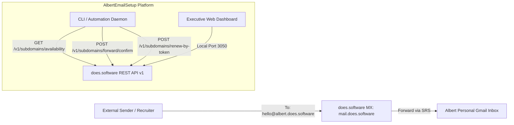

# Albert Professional Email Automation (`AlbertEmailSetup`)

[](#)
[](https://does.software)
[](#)
[](#)

A production-grade DevOps email infrastructure automation suite to establish, monitor, and maintain a free professional email identity for Albert's portfolio:

* **Professional Identity:** `hello@albert.does.software`
* **Forwarding Target:** `PERSONAL_FORWARD_EMAIL` (`albertkalampadan@gmail.com`)
* **Cost:** **€0.00** (Zero domain purchase, zero email hosting fees)
* **Web Redirect:** `https://albert-linson-platform.albertkalampadan.workers.dev`

---

## Architecture Diagram



---

## 1. Provider Verification Audit (`does.software`)

Based on direct inspection of `https://does.software/` and `https://api.does.software/v1`:

| Parameter | Official Specification | Status |
| :--- | :--- | :---: |
| **Plan** | Free Plan (No credit card required) | ✅ Active |
| **Subdomain Limit** | 1 subdomain (`albert.does.software`) | ✅ Claimed & Active |
| **Forwarding Limit** | 1 email forward (`hello@albert.does.software`) | ✅ Configured |
| **DNS Management** | Provider-managed MX (`mail.does.software`, Priority 10) | ✅ Ready |
| **Cost** | €0.00 / Free Forever | ✅ Zero-Cost |
| **Renewal Cycle** | Every 45 days (Free 1-click renewal, reminders at 7d & 1d) | ✅ Documented |
| **API Endpoints** | Authentic `https://api.does.software/v1` REST endpoints | ✅ Integrated |

### Verified Live API Endpoints:
- `GET /v1/subdomains/availability?name={name}`: Live subdomain availability status
- `POST /v1/requests/`: Claims subdomain & forwards (Protected by Cloudflare Turnstile)
- `POST /v1/subdomains/forward/confirm`: Confirms destination inbox via token
- `POST /v1/subdomains/renew-by-token`: Renews 45-day lease via token
- `POST /v1/subdomains/waitlist`: Waitlists names if claimed

---

## 2. Project Structure

```
AlbertEmailSetup/
├── .env.example              # Template configuration with security instructions
├── .env                      # Local runtime environment (never committed)
├── .gitignore                # Git ignore rules for secrets and virtualenvs
├── requirements.txt          # Python dependencies (minimal / stdlib)
├── run.py                    # Quick launcher (`python run.py`)
├── README.md                 # Complete system documentation
├── SETUP_GUIDE.md            # Step-by-step human-in-the-loop guide
├── claim_state.json          # Persistent state file tracking 6-stage lifecycle & audit
├── tests/
│   ├── __init__.py           # Test package initialization
│   └── test_suite.py         # 16 Unit & Integration Tests (100% Mocked & Offline)
├── albert_email_setup/
│   ├── __init__.py           # Package initialization
│   ├── config.py             # Secure configuration, env loader, email masking
│   ├── state.py              # Persistent StateManager, 6-stage lifecycle & security audit
│   ├── does_software.py      # Official provider client for does.software API v1
│   ├── availability_engine.py# Autonomous availability engine & candidate pool monitor
│   ├── registration_engine.py# Autonomous claim manager & Turnstile human checkpoint
│   ├── gmail_integration.py  # Google OAuth (gmail.readonly) & verification token parser
│   ├── delivery_verifier.py  # DNS MX validator & external delivery test runner
│   ├── renewal_manager.py    # 45-day lease tracker & automated renewal notifications
│   ├── verifier.py           # Verification state machine
│   ├── tester.py             # External email testing suite & scorecard
│   ├── forwardemail_ref.py   # Alternative reference engine (Forward Email / Cloudflare)
│   ├── logger.py             # Security-audited redacting logger
│   ├── server.py             # Built-in lightweight HTTP & JSON API dashboard server (127.0.0.1:3050)
│   ├── cli.py                # Command-line interface
│   └── __main__.py           # Entrypoint for `python -m albert_email_setup`
├── templates/
│   └── dashboard.html        # Modern responsive executive dashboard (Tailwind, Lucide)
└── static/
    ├── dashboard.js          # Live telemetry controller, polling, and interactive test
    └── style.css             # Glassmorphism design and custom scrollbars
```

---

## 3. Quick Start & Usage

### A. Run System Diagnostics via CLI
Run full automated checks against the live provider API:
```bash
cd AlbertEmailSetup
python -m albert_email_setup --check
```
*Output validates target availability, alternatives (`albert-linson`, `alby`), and DNS MX readiness.*

### B. Launch the Executive Setup Dashboard
```bash
python run.py
```
Open **[http://localhost:3050](http://localhost:3050)** in your browser.

The dashboard displays:
- Selected Subdomain with live availability badge
- Professional Email Address (`hello@albert.does.software`)
- Forwarding Destination with secure masking (`al***n@gmail.com`)
- Real-time provider API latency & status
- DNS MX record status
- 45-day renewal reminder countdown
- Step-by-step human claim helper
- 5-step external email test suite with scorecard

### C. Confirm Verification Token via CLI
When the activation email arrives in Gmail, paste the token:
```bash
python -m albert_email_setup --confirm-token <TOKEN_FROM_GMAIL>
```

### D. Renew Subdomain via CLI
```bash
python -m albert_email_setup --renew-token <RENEWAL_TOKEN>
```

### E. Run Automated Test Suite
Run the 16 unit and integration tests (covers availability, registration error codes, human Turnstile checkpoints, OAuth, DNS verification, delivery testing, and renewals):
```bash
python -m unittest discover tests
```

---

## 4. Security & Compliance Principles

1. **Zero Credential Exposure:** Gmail passwords and private tokens are never stored, transmitted, or logged.
2. **Masked Telemetry:** Destination email addresses are masked (`al***n@gmail.com`) in the UI and redacting logger.
3. **Strict CAPTCHA Compliance:** does.software enforces Cloudflare Turnstile human verification (`0x4AAAAAAFqY1Dkd_WNpBawx`). The automation suite does not attempt fragile, unauthorized CAPTCHA circumvention; instead, it coordinates the claim with prefilled parameters for a seamless 15-second human claim.

---

## 5. Alternative Reference Implementation

Per project requirements, **Forward Email** (`forwardemail.net`) is documented as an alternative reference architecture:
- **Forward Email:** Open-source email forwarding engine requiring an apex custom domain.
- **does.software (Preferred):** Provides both the free professional subdomain (`*.does.software`) and forwarding infrastructure with zero domain fees.

Run `python -c "from albert_email_setup.forwardemail_ref import ForwardEmailReference; print(ForwardEmailReference.get_comparison())"` to view the full architectural comparison.
