# MASTER PROJECT AUDIT: ALBERT LINSON PERSONAL INTELLIGENCE PLATFORM

**Audit Date:** November 6, 2026  
**Auditor:** Principal Software Architect & DevOps Lead (Antigravity)  
**Execution Environment:** Windows 10 Pro | PowerShell 7 | Intel Core i3 | ~3.6 GB RAM  
**Project Workspace:** `C:\Users\sheeb\Documents\resume`  

---

## 1. Executive Summary

This comprehensive audit evaluates the local development environment, all discovered source assets, reference repositories, existing ATSForge AI capabilities, Free-for-Dev catalog clones, research papers, and authentic professional records for **Albert Kalampadan Linson**. 

The goal is to unify these disparate components into a cohesive, high-performance, production-ready, cloud-deployable **Personal Intelligence Platform** featuring:
1. A **Cinematic + Professional Public Portfolio** (Next.js, React, TypeScript, Tailwind CSS, Procedural Canvas/Three.js hero with graceful fallback, interactive research library, verified career history).
2. An integrated **Private Career Studio (`/studio`)** powered by **ATSForge AI** (20-rule deterministic ATS compatibility engine, job description extractor, keyword gap analyzer, zero-hallucination factuality guard, live A4 resume builder with 6 ATS-compliant templates, vector PDF/DOCX/TXT/JSON export, and application pipeline tracker).
3. An **OpenRouter AI Gateway** (multi-model abstraction, priority free models `openrouter/free`, automatic fallback, exponential backoff, rate-limit resilience, prompt-injection defense).
4. A **FreeStack Intelligence Engine** (live ingestion of the 277 KB `ripienaar/free-for-dev` repository, Markdown AST parser, categorization, search, filtering, and database persistence).
5. An **Admin Control Center (`/admin`)** (secure authentication, CRUD operations for portfolio data, FreeStack sync triggers, AI config, system telemetry).
6. **Cloudflare Free-Tier Cloud Infrastructure** (Cloudflare Workers/Pages, Cloudflare D1 SQL database, Cloudflare R2 object storage, DNS, SSL, GitHub Actions CI/CD).

---

## 2. Environment & Tooling Verification

| Component | Detected Version | Status | Notes |
| :--- | :--- | :--- | :--- |
| **Operating System** | Windows 10 Pro (x64) | Verified | Host machine Lenovo B590 |
| **CPU / Architecture** | Intel Core i3 (2 cores / 4 threads) | Verified | Low-resource development profile |
| **Memory** | ~3.59 GB RAM available | Verified | Strict avoidance of heavy Docker/local LLMs |
| **Shell** | Windows PowerShell 7 | Verified | PowerShell-first automation scripts |
| **Node.js** | v24.18.0 | Verified | Modern LTS JavaScript runtime |
| **npm** | 11.16.0 | Verified | Package manager |
| **Python** | 3.14.7 | Verified | Fast modern Python interpreter |
| **Key Python Libs** | FastAPI 0.141, SQLAlchemy 2.0, ReportLab 5.1, python-docx 1.2, pypdf 6.21, Pydantic 2.13, Pytest 9.1 | Verified | All pre-requisite libraries pre-installed |
| **Git** | 2.55.0.windows.5 | Verified | Local source control |

---

## 3. Discovered Source Repositories & Local Assets

### 3.1 ATSForge AI (`C:\Users\sheeb\Documents\spicitifyextension\ATSForge-AI`)
- **Status:** Complete, tested local-first ATS engine.
- **Backend Architecture:** FastAPI + SQLite (`apps/backend/data/atsforge.db`).
- **Core Modules Verified:**
  - `app/services/ats/ats_engine.py`: 20 deterministic ATS rules evaluating contact, structure, action verbs, quantified achievements, and single-column formatting.
  - `app/services/matcher/job_matcher.py`: Skill extraction, mandatory vs. preferred classification, keyword stuffing detection.
  - `app/services/ai/preservation.py`: `FactualityGuard` enforcing strict zero-hallucination policies.
  - `app/services/export/exporters.py`: Vector PDF via ReportLab (100% selectable), native DOCX via python-docx, TXT, and JSON Resume.
  - `app/services/pipeline.py`: Unified tailoring pipeline.
- **Automated Tests:** 14 automated tests in `tests/unit` and `tests/integration`.
- **Reference Repositories Present:** `Resume-Matcher`, `CVAurum`, `ats-checker`, `cvtailor` inside `reference-repositories/`.

### 3.2 Free-for-Dev Catalog (`C:\Users\sheeb\Documents\spicitifyextension\free-for-dev-repo`)
- **Status:** Complete Git clone of `ripienaar/free-for-dev`.
- **Catalog Size:** 277 KB Markdown database (`README.md`) containing over 1,000 curated free-tier developer resources across 30+ categories.
- **Prototype Ingestion:** `C:\Users\sheeb\Documents\spicitifyextension\FreeForDev-Personal` contains preliminary parsing scripts (`app.js`, `site.config.js`).

### 3.3 Authentic Research Papers (`C:\Users\sheeb\Documents\Research\`)
1. **Breast Cancer Detection in Ultrasound:**  
   *Title:* "A Computational Perspective on Breast Cancer Detection in Ultrasound: Fusion of Multi-Image Modalities"  
   *Verified Accession/Doc:* `https://docs.google.com/document/d/1pZqEWrk24sMGyOaCC40F2IFIjeQafLdA/edit?usp=sharing`
2. **AEGIS-Test:**  
   *Title:* "AEGIS-Test: Adaptive Evidence-Guided Iterative Synthesis for Reliable LLM-Based Software Testing"  
   *Verified Files:* Full PDF (578 KB) & formatted DOCX in `paper 5 years oold/merged/`.
3. **EduMind:**  
   *Title:* "EduMind: Adaptive Learning and Educational Intelligence with LLMs"  
   *Verified Files:* Full manuscripts and IEEE reformatted drafts in `paper 5 years oold/researc 2/merged/`.

### 3.4 Authentic Professional Profile (`Albert_Linson_Resume.docx`)
- **Full Legal Name:** Albert Kalampadan Linson
- **Title:** Data-Driven IT Professional | AI/ML | Frontend & Graphic Design | Recruitment
- **Contact:** albertkalampadan@gmail.com | +91 9910705796 | Delhi, India
- **Education:**
  - Master of Computer Applications (MCA) (Pursuing) | CHRIST (Deemed to be University), Delhi NCR
  - Bachelor of Computer Applications (BCA) | CHRIST (Deemed to be University), Delhi NCR (Reg No: 22215011)
  - Class XII (CBSE) | St. Columba's School, New Delhi
  - Class X (CBSE) | St. Columba's School, New Delhi
- **Verified Work History:**
  - **US IT Recruiter | Innova Solutions** (Dec 2025 – July 2026): Full-cycle US IT recruitment, 70% placement improvement via structured screening, candidate pipelines.
  - **IT Manager | Herbal Energy** (Oct 2025 – Nov 2025): IT infrastructure management, website modernization, vendor coordination.
  - **Business Development Executive | Algospark Technologies** (Aug 2025 – Oct 2025): Market research, lead generation, client presentations, B2B sales pipelines.
  - **Frontend Developer & UI/UX Designer Intern | Municipal Corporation of Delhi** (May 2024 – Apr 2025): Figma/Adobe XD design, civic web portal usability improvements (70% reduction in user-reported issues).

### 3.5 Real Software Projects Audited
1. **JARVIS Desktop Assistant:** Located at `C:\Users\sheeb\Documents\fsd\jarvis` (Electron + Python desktop AI assistant).
2. **Lunova OS:** Located at `C:\Users\sheeb\Documents\fsd` (Custom OS kernel, bootloader, driver architecture).
3. **ATSForge AI:** Located at `C:\Users\sheeb\Documents\spicitifyextension\ATSForge-AI` (Comprehensive resume optimization system).
4. **MCD Civic Portal & Dashboard:** Municipal Corporation of Delhi public services dashboard.
5. **CINEMATRIX AI:** AI movie recommendation and cinematic intelligence engine.
6. **AURIVA:** Intelligent digital experience platform.
7. **FunBot & SpeechoBot:** Conversational bot and speech recognition systems.

---

## 4. Architectural Analysis & Integration Strategy

```mermaid
graph TD
    subgraph ClientLayer["Frontend & Client Layer (Next.js 14 App Router)"]
        Public["Public Portfolio (/about, /experience, /projects, /research)"]
        Hero3D["Procedural Canvas / Hero3D + Fallback"]
        Studio["Career Studio (/studio - Live Builder, JD Matcher)"]
        FreeStackUI["FreeStack Catalog (/freestack - Search & Filter)"]
        AdminUI["Admin Studio (/admin - Secured)"]
    end

    subgraph ServiceLayer["Unified Backend & Edge API Layer"]
        NextAPI["Next.js Route Handlers / Cloudflare Workers"]
        FastAPIService["Python FastAPI Service (Local & Container/Worker Microservice)"]
        OpenRouter["OpenRouter Gateway (openrouter/free + Fallback)"]
    end

    subgraph CoreEngines["Core Business Logic"]
        ATSEngine["Deterministic 20-Rule ATS Engine"]
        Matcher["JD Extractor & Gap Analyzer"]
        Factuality["Zero-Hallucination Factuality Guard"]
        Exporters["PDF (ReportLab/Client Vector), DOCX, TXT, JSON"]
        FreeStackSync["Markdown AST Parser & Sync Engine"]
    end

    subgraph StorageLayer["Data & Persistence Layer"]
        D1["Cloudflare D1 / SQLite (Local)"]
        R2["Cloudflare R2 / Local FS (Private Storage)"]
        ProfileData["shared/profile_data.json (Master Source of Truth)"]
    end

    Public --> NextAPI
    Studio --> NextAPI
    FreeStackUI --> NextAPI
    AdminUI --> NextAPI

    NextAPI --> OpenRouter
    NextAPI --> D1
    NextAPI --> R2
    NextAPI --> ProfileData
    NextAPI --> ATSEngine
    NextAPI --> Matcher
    NextAPI --> Factuality
    NextAPI --> Exporters

    FastAPIService --> ATSEngine
    FastAPIService --> Exporters
```

### Key Architectural Resolutions:
1. **Dual-Mode Engine (TypeScript Edge + Python Microservice):**
   - The deterministic ATS scoring rules, keyword gap analyzer, factuality guard, and FreeStack parser are implemented natively in TypeScript within the Next.js API/Edge runtime for zero-cold-start, serverless Cloudflare Workers execution.
   - The Python FastAPI backend (with ReportLab vector PDF and python-docx generation) is preserved, integrated, and wrapped with CLI and test runners, enabling full compatibility in local, containerized, and microservice contexts.
2. **Master Profile as Source of Truth:**
   - Albert Linson's complete, verified record is structured in `packages/shared/profile_data.json` with strict schema validation. Both the public site and ATSForge resume generators query this identical master profile.
3. **No Unverified Data:**
   - Zero hallucination in public claims or generated resumes. Unverified metrics will use explicit placeholders (`[e.g., improved efficiency by X%]`).

---

## 5. Milestone 1 Acceptance & Status

- [x] Complete environment inspection performed.
- [x] All existing source code directories located and verified.
- [x] Reference repositories audited.
- [x] Python test suite executed and failure causes diagnosed (SQLite path resolution).
- [x] Real resume, research manuscripts, and project assets indexed.
- [x] Master audit document created at `docs/MASTER_PROJECT_AUDIT.md`.

*Milestone 1 is complete. Proceeding immediately to Milestone 2: Production Architecture and Free-Tier Infrastructure Audit.*
